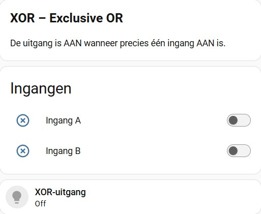
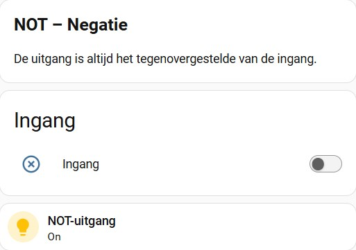

| [Nederlands](README.md) |
|:---:|


[](https://www.home-assistant.io/)
[](Automations.yaml)
[](Dashboard.yaml)


# Home Assistant – Logische voorwaarden: XOR en NOT

Met twee virtuele schakelaars en vier eenvoudige automations laat ik zien hoe de logische functies XOR (EXCLUSIVE OR) en NOT (NEGATIE) werken en hoe je deze in Home Assistant kunt toepassen.

Het project bestaat uit twee simulaties en twee praktische toepassingen. Met behulp van een dashboard kun je zelf de ingangen bedienen en direct zien wat de logische uitkomst is.

Voor de simulaties zijn geen fysieke apparaten of sensoren nodig. Alles werkt met `input_boolean`-helpers.

<p align="center">
  
  <br><br>
  
</p>

## 1. Waarom gaan we hiermee aan de slag?

Binnen Home Assistant bepalen logische voorwaarden wanneer een automation wel of niet wordt uitgevoerd.
Naast de bekende voorwaarden AND (EN) en OR (OF) zijn er nog twee interessante logische functies: XOR en NOT.

- **XOR (Exclusive OR):** de uitkomst is waar wanneer precies één van de twee voorwaarden waar is.
- **NOT (Negatie):** keert de uitkomst van een voorwaarde om. Waar wordt onwaar en onwaar wordt waar.

Door deze functies te begrijpen, kun je ook minder voor de hand liggende automatiseringen maken.
In dit project maak ik de werking inzichtelijk met behulp van virtuele schakelaars en een overzichtelijk simulatie-dashboard.

### Een logisch vervolg op AND en OR

Dit project is een vervolg op het eerdere project [Logische voorwaarden – AND, OR en combinaties](https://github.com/henkhoekema/Logische-voorwaarden-AND-OR-en-combinaties).

In dat project hebben we kennisgemaakt met AND (EN), OR (OF) en het combineren van verschillende logische voorwaarden. Daarmee hebben we de basis gelegd voor het werken met logica binnen Home Assistant.
In dit vervolg breiden we die kennis uit met twee aanvullende logische functies: XOR (EXCLUSIVE OR) en NOT (NEGATIE).
Samen vormen deze vier functies een mooie basis om logische voorwaarden beter te begrijpen en steeds geavanceerdere automatiseringen in Home Assistant te bouwen.
Heb je het eerste project nog niet bekeken? Dan is het een aanrader om daarmee te beginnen.

## 2. XOR (Exclusive OR)

Bij een XOR-voorwaarde is de uitkomst alleen waar wanneer de twee ingangen verschillend zijn.
Er mag dus precies één ingang waar zijn.

**Voorbeeld:**

Een lamp mag alleen inschakelen als:

- Schakelaar A aanstaat.
- Schakelaar B uitstaat.

OF:

- Schakelaar A uitstaat.
- Schakelaar B aanstaat.

Wanneer beide schakelaars dezelfde status hebben, blijft de lamp uit.

De logica:

`A XOR B`

**Waarheidstabel:**

| A | B | Resultaat |
|---|---|---|
| Uit | Uit | Onwaar |
| Uit | Aan | Waar |
| Aan | Uit | Waar |
| Aan | Aan | Onwaar |

In Home Assistant:

```yaml
- condition: template
  value_template: >
    {{ is_state('input_boolean.xor_a', 'on')
       != is_state('input_boolean.xor_b', 'on') }}
```

De operator `!=` betekent dat beide waarden niet gelijk aan elkaar mogen zijn.
Dat is precies de werking van XOR.

## 3. NOT (Negatie)

Bij een NOT-voorwaarde wordt de oorspronkelijke status omgekeerd.

- Wanneer de ingang waar is, wordt de uitkomst onwaar.
- Wanneer de ingang onwaar is, wordt de uitkomst waar.

**Voorbeeld:**

Een verwarming mag alleen actief zijn wanneer een raam gesloten is.

De logica:

`NOT A`

**Waarheidstabel:**

| Ingang | Resultaat |
|---|---|
| Uit | Waar |
| Aan | Onwaar |

In Home Assistant:

```yaml
- condition: not
  conditions:
    - condition: state
      entity_id: input_boolean.voorbeeld
      state: "on"
```

De NOT-voorwaarde zorgt ervoor dat de onderliggende voorwaarde juist niet waar mag zijn.
Een andere mogelijkheid is het omkeren van een status met een template:

```yaml
{{ is_state('input_boolean.voorbeeld', 'off') }}
```

## 4. Triggers en conditions: het verschil

Het is belangrijk om onderscheid te maken tussen triggers en conditions binnen Home Assistant.

Bijvoorbeeld:

```yaml
triggers:
  - trigger: state
    entity_id:
      - input_boolean.xor_a
      - input_boolean.xor_b
```

De automation wordt gestart zodra één van de twee schakelaars verandert.
Wanneer je meerdere triggers opgeeft, is het voldoende dat één trigger optreedt. Dit werkt standaard als OR (OF).

Hier kun je gebruikmaken van onder andere:

- AND: alle voorwaarden moeten waar zijn.
- OR: minimaal één voorwaarde moet waar zijn.
- NOT: de opgegeven voorwaarde mag niet waar zijn.
- Template: hiermee kun je zelf logische vergelijkingen maken, zoals XOR.

Belangrijk: XOR is geen afzonderlijke standaard condition in Home Assistant. In dit project gebruiken we daarom een template met de vergelijking `!=`.

## 5. XOR en NOT in de praktijk

Naast de simulaties bevat dit project twee praktische voorbeelden.

### 5.1 XOR – Twee bewegingsmelders

Stel dat je twee bewegingsmelders hebt:

- Bewegingsmelder woonkamer.
- Bewegingsmelder hal.

Je wilt een waarschuwingslamp inschakelen wanneer precies één van de twee melders beweging detecteert.

| Woonkamer | Hal | Lamp |
|---|---|---|
| Uit | Uit | Uit |
| Uit | Aan | Aan |
| Aan | Uit | Aan |
| Aan | Aan | Uit |

De logica:

`A XOR B`

De automation vergelijkt de status van beide bewegingsmelders. Alleen wanneer deze verschillend zijn, wordt de waarschuwingslamp ingeschakeld.

### 5.2 NOT – Verwarming bij gesloten raam

Een raamcontact geeft aan of een raam geopend of gesloten is.
We willen een helper gebruiken die aangeeft of verwarming is toegestaan.

- Raam gesloten: verwarming toegestaan.
- Raam geopend: verwarming niet toegestaan.

De logica:

`NOT A`

De automation keert de status van het raamcontact om en schrijft het resultaat naar een virtuele schakelaar.
Deze helper kan vervolgens als voorwaarde worden gebruikt in een andere verwarmingsautomation.
De NOT-automation schakelt de verwarming zelf dus niet rechtstreeks.

## 6. Vergelijking van XOR en NOT

De onderstaande tabel laat zien wat beide logische functies opleveren.

| A | B | XOR | NOT A |
|---|---|---|---|
| 0 | 0 | 0 | 1 |
| 0 | 1 | 1 | 1 |
| 1 | 0 | 1 | 0 |
| 1 | 1 | 0 | 0 |

Hierbij geldt:

- `1` betekent waar (aan).
- `0` betekent onwaar (uit).

Een interessant verschil:
Bij XOR zijn twee ingangen nodig en wordt gekeken of deze verschillend zijn.
Bij NOT wordt slechts één ingang gebruikt en wordt de status daarvan omgekeerd.

## 7. Home Assistant-configuratie

Voor dit project worden vijf `input_boolean`-helpers gebruikt.

Deze kun je aanmaken via:

**Instellingen → Apparaten en diensten → Helpers → Helper aanmaken → Schakelaar**

### Invoerschakelaars

| Entity | Functie |
|---|---|
| `input_boolean.xor_a` | XOR ingang A |
| `input_boolean.xor_b` | XOR ingang B |
| `input_boolean.not_input` | NOT ingang |

### Resultaathelpers

| Entity | Functie |
|---|---|
| `input_boolean.xor_result` | Uitkomst XOR |
| `input_boolean.not_result` | Uitkomst NOT |

De twee simulatie-automations reageren op wijzigingen van de invoerschakelaars.
Afhankelijk van de ingestelde logica wordt de bijbehorende resultaathelper ingeschakeld of uitgeschakeld.
Ook na een herstart van Home Assistant worden de resultaten opnieuw berekend.

### Bestanden

Het project bestaat uit twee afzonderlijke YAML-bestanden:

- `automations.yaml` – bevat de vier automatiseringen.
- `dashboard.yaml` – bevat de kaarten voor het simulatie-dashboard.

De praktische voorbeelden gebruiken daarnaast de volgende eigen entiteiten. Deze moet je eventueel aanpassen aan je eigen installatie:

| Entity | Functie |
|---|---|
| `binary_sensor.beweging_woonkamer` | Bewegingsmelder woonkamer |
| `binary_sensor.beweging_hal` | Bewegingsmelder hal |
| `light.waarschuwingslamp` | Waarschuwingslamp |
| `binary_sensor.raam_woonkamer` | Raamcontact woonkamer |
| `input_boolean.verwarming_toegestaan` | Verwarming toegestaan |

De praktische voorbeelden zijn dus afhankelijk van de aanwezigheid van deze entiteiten.

## 8. Dashboard

Het dashboard bestaat uit vijf onderdelen:

**1. XOR-simulatie**

Hiermee kun je de twee virtuele schakelaars afzonderlijk bedienen. De uitkomst wordt direct weergegeven.

**2. NOT-simulatie**

Hier bedien je één virtuele schakelaar. De uitgang toont steeds de tegenovergestelde status.

**3. Waarheidstabellen**

Deze laten zien welke uitkomst bij iedere mogelijke combinatie hoort.

**4. XOR – Bewegingsmelders**

Hier worden de twee bewegingsmelders en de bijbehorende waarschuwingslamp weergegeven.

**5. NOT – Raam en verwarming**

Hier zie je de status van het raamcontact en of verwarming is toegestaan.
Door verschillende combinaties uit te proberen, wordt direct zichtbaar hoe de logische functies werken.
Er is voor de simulaties geen aanvullende hardware of integratie nodig.

## 9. En wat hebben we nu ontdekt?

XOR en NOT zijn twee aanvullende logische functies waarmee je de mogelijkheden van Home Assistant verder kunt uitbreiden.
XOR kijkt of twee voorwaarden verschillend zijn. NOT keert een bestaande voorwaarde om.
Hoewel beide functies eenvoudig lijken, kunnen ze in bepaalde situaties bijzonder nuttig zijn.
Met de virtuele schakelaars en het simulatie-dashboard heb je een eenvoudige manier om de werking te begrijpen en zelf te testen.
Samen met AND en OR vormen deze logische functies een mooie basis voor het maken van slimme en geavanceerde automatiseringen in Home Assistant.

## Licentie en gebruiksvoorwaarden

Deze automatisering mag vrij worden gebruikt en aangepast voor eigen gebruik.

Bij het publiceren, verspreiden of delen van deze automatisering, of van geheel of gedeeltelijk daarop gebaseerde aangepaste versies, is bronvermelding verplicht. Daarbij moet de oorspronkelijke auteur worden vermeld en moet, waar redelijkerwijs mogelijk, een verwijzing naar de oorspronkelijke repository worden opgenomen.

Het is niet toegestaan deze automatisering of afgeleide versies als volledig eigen oorspronkelijk werk te presenteren zonder de oorspronkelijke auteur te erkennen.

Deze automatisering wordt aangeboden zonder enige garantie. Gebruik en aanpassing geschieden op eigen risico. Voor zover wettelijk toegestaan aanvaardt de auteur geen aansprakelijkheid voor schade die voortvloeit uit het gebruik of de aanpassing ervan.


 

